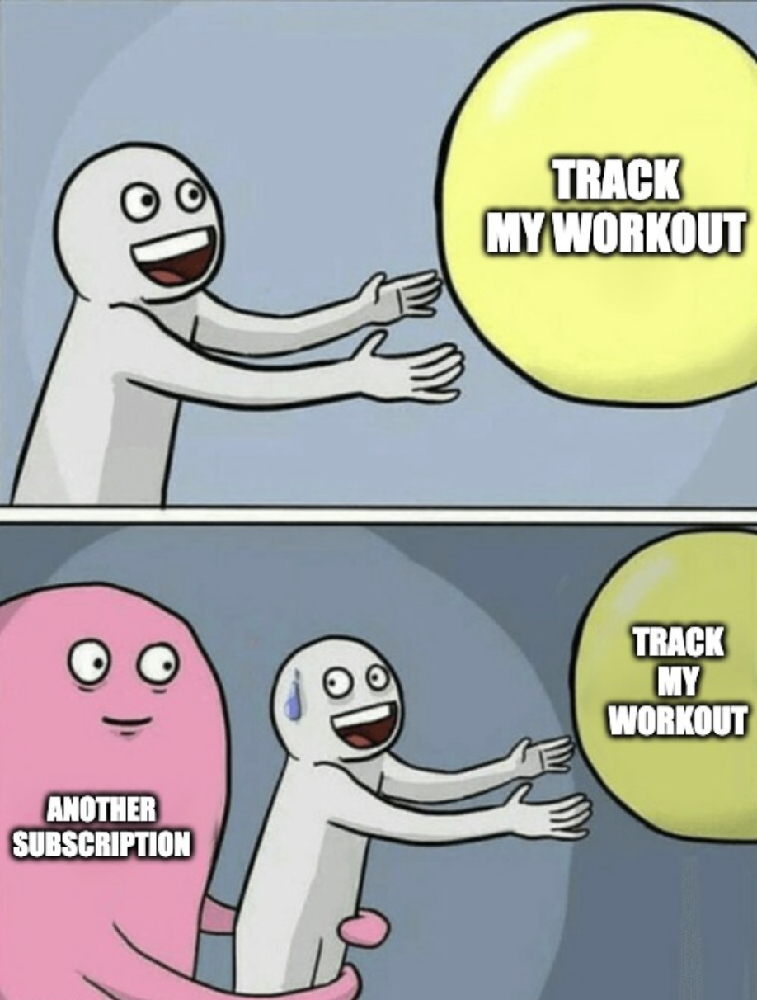
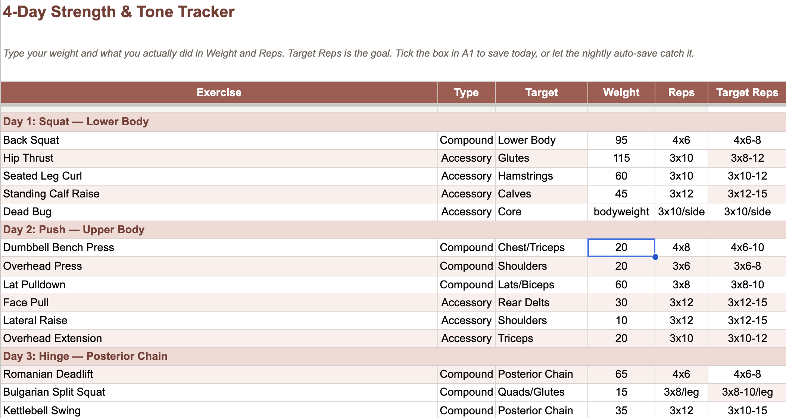
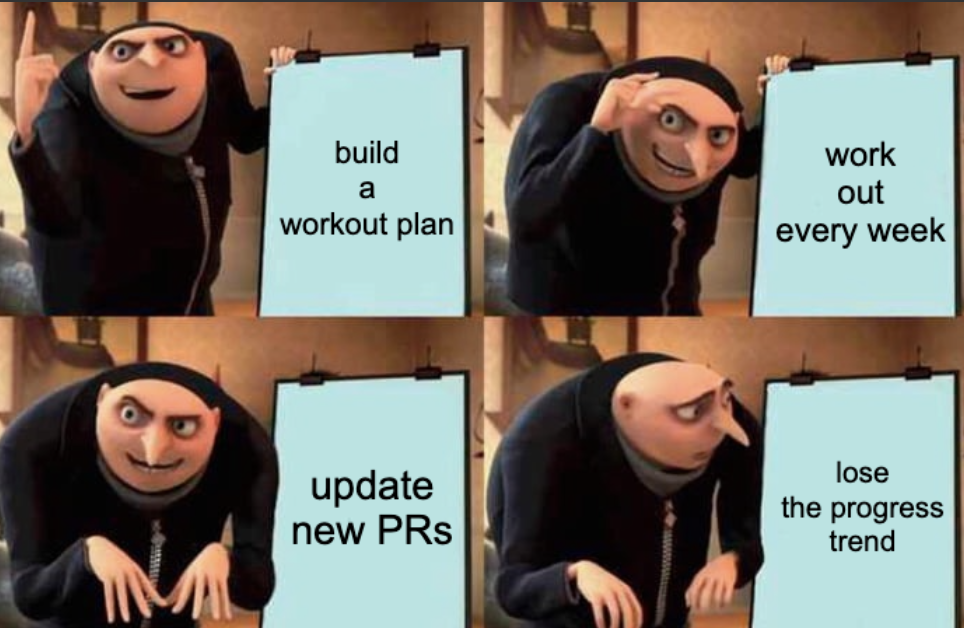
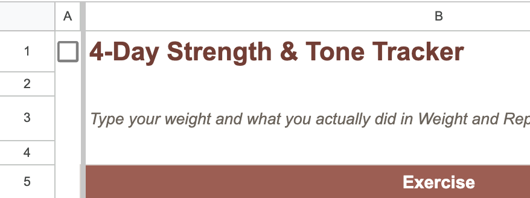
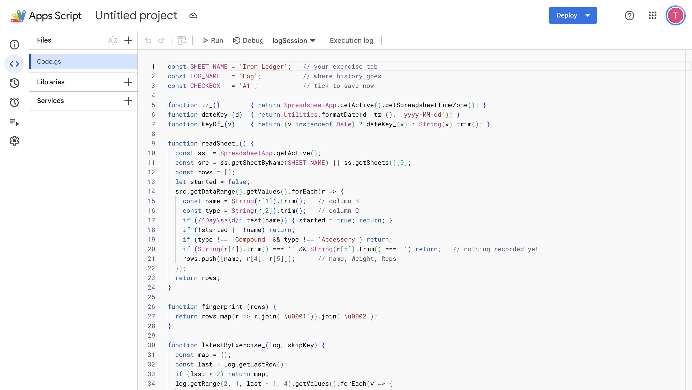
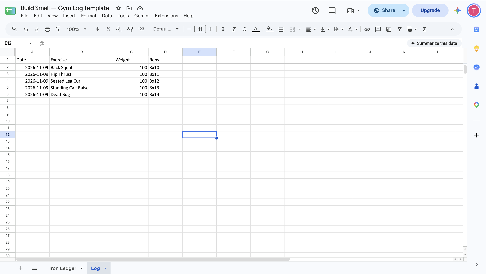

Every fitness app wants the same thing from me. Download it. Make an account. Verify my email. Pick a plan. Turn on notifications. Unlock "insights."

Dang it, I just want to write down how much I squatted.

So this is the build: a Google Sheet that tracks my lifts, remembers every session, and saves itself every night. No new app, no new login. You can copy it in about 10 minutes.

## The problem

My goals are pretty normal. Build some muscle, lose some fat, look lean, and stay functional enough to keep playing sports without wrecking my knees.

What I wanted was boring: one page, every exercise, my weight and reps, done. Everything else in my life already lives in Google Drive. Why can't my workouts live there too?

## What I used

- Google Sheets, which I already had
- Apps Script, which is built into Sheets (I had just never opened it)
- Claude, to draft my starting plan and write the script

| Option | Why I passed |
| --- | --- |
| Gym apps | Another app, another login, and I'd have to rebuild my whole program inside it |
| Apple Fitness | Tracks workouts, not the weight on the bar |
| A custom web app | I actually built one. Never opened it, because it wasn't where I already look |
| Google Sheet + Apps Script | The winner. It lives where I already am |

## Week zero: the sheet

I asked Claude for a 4-day plan built around my goals, laid out as a sheet. One row per exercise, with columns for weight, reps and target reps.

It looked great. I opened it at the gym, typed in my numbers, and felt extremely organized.

## Week one: wait, where did my progress go?

After a week I was clearly getting stronger. My squat went up. But the sheet couldn't show it, because every time I typed a new weight, the old one disappeared. Overwritten. Gone. Like it never happened.

A tracker with no history is just a whiteboard.

## Part 2: a save button with Apps Script

The fix is a Log tab and a small script. Tick the checkbox in cell A1, and the script copies the exercises you changed into Log with today's date. Then the box unticks itself, ready for next time.

Why a checkbox and not a real button? Buttons drawn on a sheet don't run scripts in the Sheets phone app, and I'm literally holding my phone at the gym. Ticking a checkbox counts as editing a cell, and that's what triggers the script.

It's about 90 lines, which is a lot to scroll past, so it lives in a file: **[download gym-log.gs](/downloads/gym-log.gs)** (or [read it on GitHub](https://github.com/tduong191/tduong191.github.io/blob/main/public/downloads/gym-log.gs) first, which you should probably do before running a stranger's script).

Open Extensions → Apps Script, delete the stub `myFunction`, and paste the whole file in. If your exercise tab isn't called Iron Ledger, change `SHEET_NAME` on the first line.

## Part 2.1: I kept forgetting to tick the box

Turns out the hardest part of a save button is remembering to press it. Last set done, bag on my shoulder, already thinking about work, and boom: the session never got logged.

So now it saves itself. Every night between 9 and 10pm, the script asks one question: which exercises changed since they were last logged? Only those get saved. If nothing changed, it saves nothing, so rest days don't turn into fake workouts.

If it saves twice in one day, it replaces that day instead of making a duplicate. The checkbox still works any time you want to save right away.

## Copy it

You need two things: your exercises, and the script.

**Option 1: copy my template.** [Make a copy of the Build Small gym template](https://docs.google.com/spreadsheets/d/1v0qiOfv51VeTN_-9X-op0iDxbvebptbnFTYKR_lcErY/copy). It comes with the sheet, the Log tab and the script already inside. Then do the one-time setup below.

**Option 2: use your own sheet.** Put exercise names in column B, Type (Compound or Accessory) in column C, Weight in column E and Reps in column F. Put a row that starts with "Day 1" above your first exercise. Add a tab called `Log`, then go to Extensions → Apps Script and paste [the script from Part 2](#part-2-a-save-button-with-apps-script).

**One-time setup, for both options:**

1. In Apps Script, pick `installAutoSave` from the dropdown and hit Run.
2. Approve the permissions. Google will warn that it hasn't verified the app. That's normal for a script you made yourself: click Advanced and continue.
3. Back in the sheet, click cell A1 on your exercise tab and choose Insert → Checkbox.

That's it. Tick the box to save now, or let the nightly save catch it.

## What's next

- A trend chart for each lift, now that there's real history to look at
